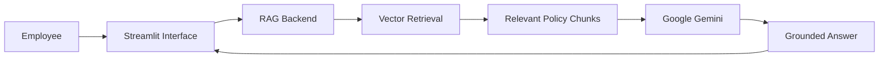
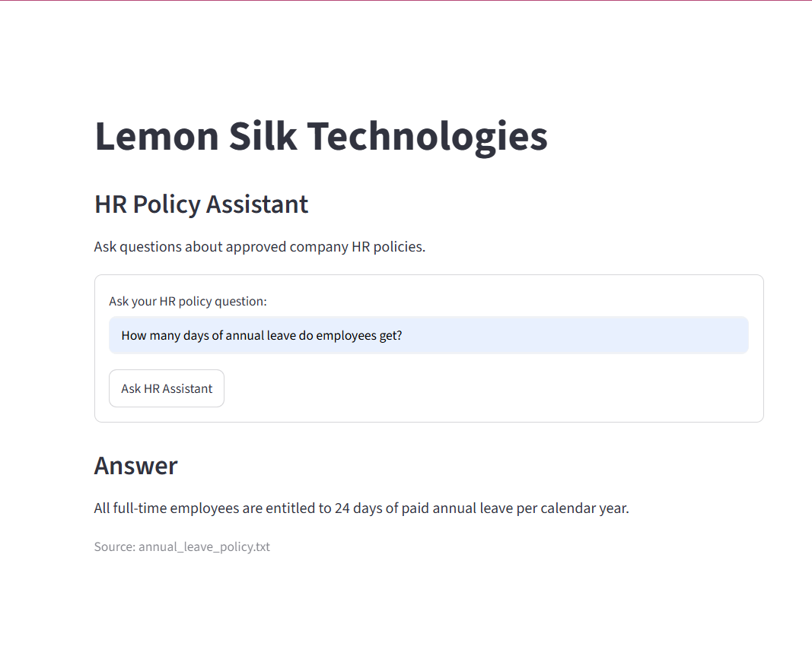
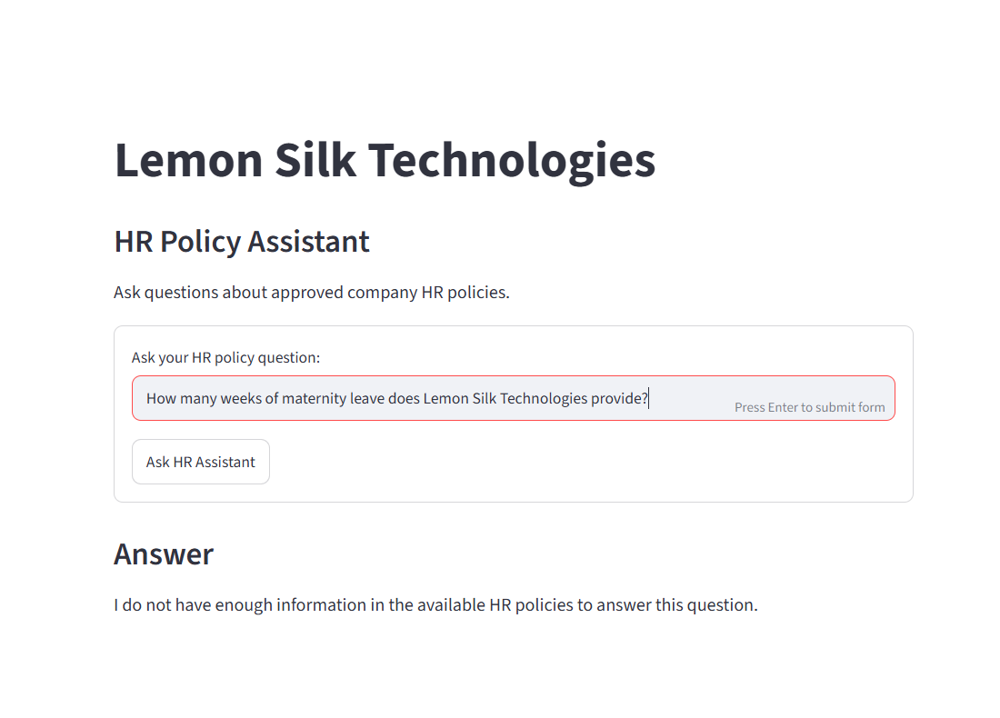

# Lemon Silk Technologies — HR Policy Knowledge Assistant

## Project Overview

The HR Policy Knowledge Assistant is a RAG-based AI application designed to help employees quickly find reliable answers to common HR policy questions.

Instead of manually searching through policy documents or contacting HR for routine queries, employees can ask questions in natural language. The assistant retrieves relevant information from approved HR policy documents and uses that information to generate a grounded, employee-friendly response.

## Business Problem

Employees often spend time searching through HR documents or contacting HR for routine policy information. This can create delays for employees and repetitive work for HR teams.

## Solution

The solution uses Retrieval-Augmented Generation (RAG) to retrieve relevant information from approved HR policy documents before generating an answer.

The application is designed to:

- Answer employee questions in natural language.
- Ground responses in available HR policy information.
- Provide source traceability when supporting information is available.
- Avoid inventing answers when the available policies do not contain sufficient information.

## Solution Architecture

At a high level, the application has an ingestion side that prepares HR policy documents for retrieval and a query-time side that retrieves relevant policy information and uses it to ground the LLM response.

### Application Flow

## Solution Architecture

At a high level, the application has an ingestion side that prepares HR policy documents for retrieval and a query-time side that retrieves relevant policy information and uses it to ground the LLM response.

### Application Flow

## Technology Stack

- **Python** — application and RAG backend
- **LangChain** — RAG workflow components
- **Hugging Face Sentence Transformers** — document embeddings
- **InMemoryVectorStore** — vector storage and similarity search
- **Google Gemini** — grounded answer generation
- **Streamlit** — employee-facing web interface

## Evaluation and Testing

The application was tested across multiple scenarios to evaluate retrieval quality, groundedness and no-answer behaviour.

Testing included:

- Direct policy questions.
- Semantically phrased questions that did not exactly match policy wording.
- Questions where the required information was not available in the policy documents.
- Inspection of retrieved evidence to distinguish retrieval failures from generation failures.
- Validation that unsupported questions produce a controlled no-answer response.
- Validation that unrelated retrieved documents are not presented as supporting sources when the assistant abstains.

## Security Considerations

- API keys and environment secrets are stored locally and excluded from version control.
- The MVP uses fictional, non-sensitive HR policy documents intended for all employees.
- Role-based access control (RBAC) and confidential employee records are outside the scope of this MVP.
- A production enterprise implementation would require appropriate authentication, authorization, access controls, monitoring and governance.

## Current Limitations

This project is an MVP designed to demonstrate the core RAG workflow.

Current limitations include:

- Uses a small set of fictional HR policy documents.
- Uses an in-memory vector store rather than a persistent enterprise vector database.
- Does not implement enterprise authentication or role-based access control.
- Does not connect to live HR systems.
- Does not automatically manage policy freshness or re-indexing.
- Citation validation uses simplified MVP logic rather than production-grade evidence validation.

## Setup and Running the Application

1. Clone or download the repository.
2. Install the required Python dependencies listed in `requirements.txt`.
3. Create a local `.env` file and configure the required Google Gemini API key.
4. Ensure the HR policy documents are available in the `hr_policies` folder.
5. Run the Streamlit application.
6. Open the local Streamlit interface in a web browser and ask an HR policy question.

> API keys and other secrets must not be committed to the repository.

## Application Screenshots

## Application Screenshots

### Grounded HR Policy Answer

The assistant answers an employee question using the available HR policy information and displays the supporting source.

### Controlled No-Answer Behaviour

When the requested information is not available in the approved HR policies, the assistant clearly states that it does not have enough information rather than inventing an answer.

